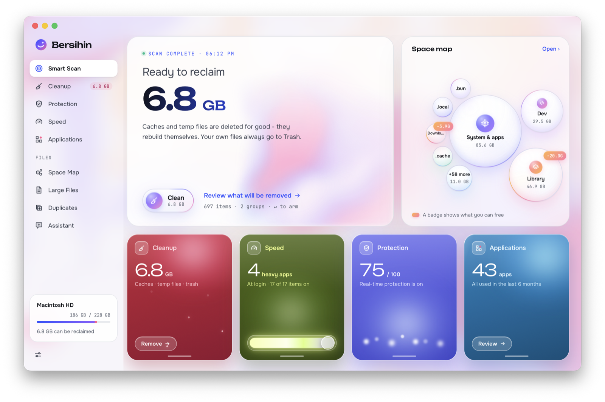
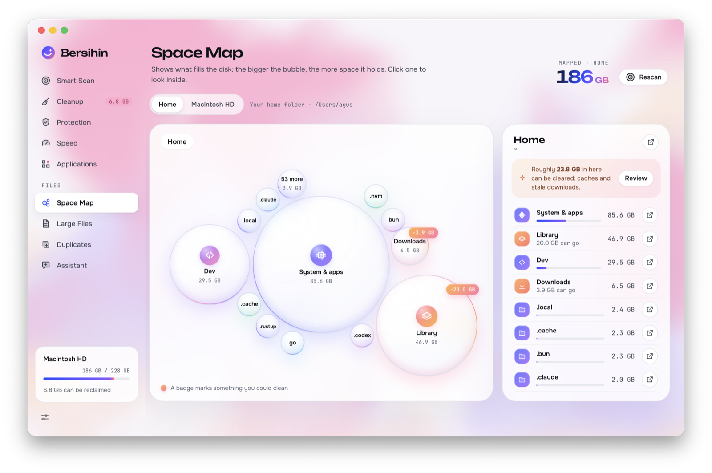
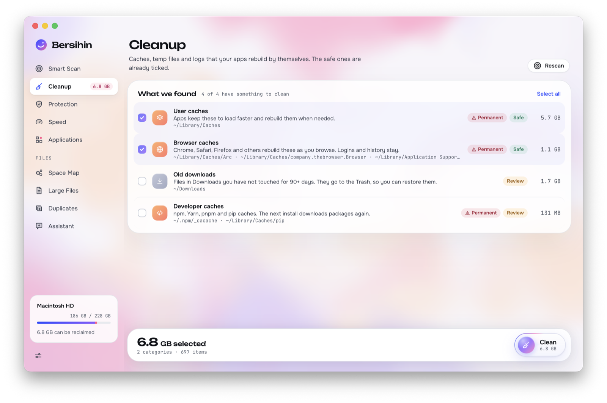
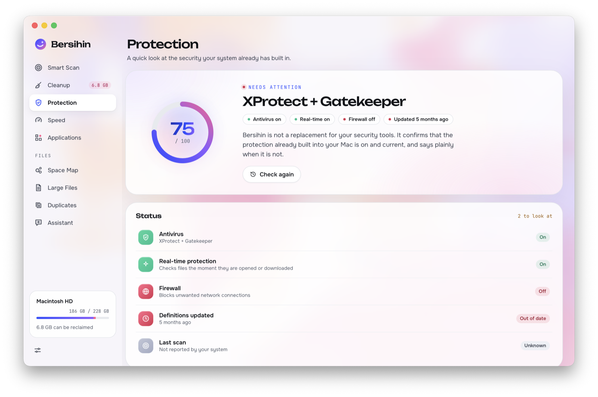

# Bersihin

A disk cleaner for macOS and Windows. Smart Scan, cache cleanup, large files, duplicates, startup items, app uninstall, a protection check and a space map, in one small native app built with Go and [MyGo](https://mygo.egoist.dev/) (React UI in the system web view, no bundled Chromium).

macOS on Apple silicon and Intel. Windows 10 and 11 on x64 and Arm64 is new in 0.2 and still a preview: see [Windows](#windows).



| Space Map | Cleanup | Protection |
|---|---|---|
|  |  |  |

## What it scans

Everything is read-only until you confirm an action.

| Screen | What it looks at |
|---|---|
| **Cleanup** | User caches (`~/Library/Caches`, minus browser, developer and system-owned caches), logs (`~/Library/Logs`), browser caches (Chrome, Brave, Edge, Arc, Safari, Vivaldi, Opera, Firefox, every profile), Xcode leftovers (`DerivedData`, `iOS DeviceSupport`, `CoreSimulator/Caches`), developer caches (npm, Yarn, pnpm, pip, Gradle), the Trash (`~/.Trash`), and old downloads (top-level items in `~/Downloads` untouched for 90+ days). User caches, logs and browser caches are ticked by default; the rest you tick yourself. |
| **Large Files** | Files of at least 500 MB (change it in Settings, 10 MB to 100 GB) in your home folder and on other local data drives, biggest 300 shown. Skips `~/Library`, hidden folders, app and library packages, git repositories, VM and container stores, and other volumes. |
| **Duplicates** | Files of 1 MB or more in Desktop, Documents, Downloads, Pictures, Movies and Music, compared by size, then a quick hash, then a full SHA-256. Skips iCloud files that are not downloaded, hard links and packages. The newest copy stays. |
| **Space Map** | How your home folder (two levels deep) and each local drive is used, with what can be freed in each folder. |
| **Speed** | Startup items in `~/Library/LaunchAgents` and `/Library/LaunchAgents`. |
| **Applications** | Apps in `/Applications` and `~/Applications`, with size and last-used date. Apple's own apps are locked. |
| **Protection** | Gatekeeper, the application firewall, System Integrity Protection and the XProtect version. Read-only. |
| **Smart Scan** | Runs Cleanup's scan and maps your home folder, then sums it up. |
| **Assistant** | Optional. With your own Claude or OpenAI key, it sends file names, paths (home shown as `~`) and sizes, never file contents, and shows you exactly what will be sent first. |

## Install

The app is not signed with a Developer ID or notarized yet, so macOS blocks it on first launch. After installing, clear the quarantine flag once:

1. Open `bersihin-<version>.dmg` and drag **Bersihin** to **Applications**.
2. Run:

   ```sh
   xattr -cr /Applications/Bersihin.app
   ```

3. Open Bersihin from Applications.

macOS asks for access to Desktop, Documents and Downloads the first time a scan reads them. Turning a system-wide startup item on or off asks for your admin password.

## Windows

Bersihin 0.2 runs on Windows 10 and 11 (x64 and Arm64), with every screen of the Mac version. It is a preview: it was written and checked on Linux, its Windows test suite has run under Wine but not yet on a real Windows PC, so please report what you see.

| Screen | What it looks at on Windows |
|---|---|
| **Cleanup** | Your Temp folder (`%LOCALAPPDATA%\Temp` only, whatever `%TEMP%` says), crash dumps (`%LOCALAPPDATA%\CrashDumps`), browser caches (Chrome, Edge, Brave, Vivaldi, Opera, Firefox, every profile), developer caches (npm, pnpm, Yarn, pip, Gradle), the Recycle Bin, and old downloads (top-level items in `Downloads` untouched for 90+ days, which go to the Recycle Bin). Temp files, crash dumps and browser caches are ticked by default; the rest you tick yourself. Nothing that needs administrator rights is cleaned, and nothing in `AppData\Roaming` or in the `Microsoft` folders of AppData apart from Edge's own caches. |
| **Large Files** | Your profile and the other fixed drives. Skips `AppData`, the Windows folders of a drive (`Windows`, `Program Files`, `ProgramData`, `$Recycle.Bin`...), VM and container stores, and OneDrive files that are online only. |
| **Duplicates** | Desktop, Documents, Downloads, Pictures, Videos and Music, as on the Mac. Online-only OneDrive files are never read. |
| **Space Map** | Your profile and each fixed drive. |
| **Speed** | Startup apps as Task Manager lists them: the `Run` keys (yours, every user's, and the 32-bit view), your Startup folder and the all-users one, and Task Scheduler tasks that run at sign-in. |
| **Applications** | The programs of Settings > Apps, from the `Uninstall` keys of the registry (for every user, both views, and yours), with publisher, version, size and install date. |
| **Protection** | What Windows Security reports: Microsoft Defender (or the antivirus that replaced it), real-time protection, the age of its security intelligence and the last scan, the firewall of each network profile, SmartScreen, and BitLocker on the system drive. Read-only. |

Your own files go to the **Recycle Bin**, through the same undoable shell operation File Explorer uses: an item that Windows would delete for good instead (on a drive without a Recycle Bin, or too big for it) is left where it is. Protected and never offered: `C:\Windows`, `Program Files`, `Program Files (x86)`, `ProgramData`, all of `AppData` (its `Microsoft` folders hold your credentials and keys), `.ssh`, `.gnupg`, `.aws` and other credential folders, OneDrive and other synced folders, and your Documents, Desktop and the other profile folders themselves, wherever Windows keeps them. Names are compared without case, only plain drive letter paths are accepted (no network shares), and junctions and other reparse points are never followed.

What Bersihin changes on Windows, and how:

- **Emptying the Recycle Bin** (Cleanup, never ticked by default) empties the bins of every drive with the shell's own call, after you confirm. If the bin holds more after the scan (more items or more bytes), it is left as it is and you are asked to scan again. The shell only reports totals, so a file deleted after the scan while another of at least its size was restored would not be noticed: scan right before you empty it.
- **Uninstalling** opens the program's own uninstaller (`msiexec /x` for Windows Installer programs), after you confirm in Bersihin, as Settings > Apps does (never the silent `QuietUninstallString`). Windows shows its permission prompt (UAC) when the uninstaller needs one; Bersihin never asks for administrator rights itself. The program stays in the list until the uninstaller has finished and you look again. Windows' own parts and runtimes (Visual C++, .NET, Edge, WebView2) and entries that say they may not be removed are locked; system components and updates are not listed, as in Settings.
- **Startup apps** are turned on and off the way Task Manager does it, with their `StartupApproved` setting in your part of the registry: the entry itself is never deleted, and turning it back on restores it. Startup apps of every user and sign-in tasks would need administrator rights, so they are shown read-only, with where to change them (Task Manager or Task Scheduler).
- **Protection** changes nothing. It runs one Windows PowerShell command (no profile, no rights asked) that reads the status.

### Not supported on Windows (yet)

- **Admin-only places** are deliberately left out of Cleanup: `C:\Windows\Temp`, Windows Update leftovers (`SoftwareDistribution`), Delivery Optimization files, `Windows.old` and the like. Use Windows' own Disk Cleanup or Storage Sense for them.
- **Code signing**: the installer and the app are not code-signed, so SmartScreen warns on first run (see below). Signing needs a certificate the project does not have yet.
- **Old downloads** are judged by the file's own dates (modified, created, accessed, changed) and by the shortcuts of Recent Items, which File Explorer writes when you open a file. NTFS often does not update the access time, and there is no counterpart to the Mac's Spotlight "last used" date, so a download that was opened by an app without going through File Explorer, and never changed, can still be offered as 90+ days old. The category is never ticked by default, and its files go to the Recycle Bin.
- **Startup apps of every user and sign-in tasks** cannot be changed from Bersihin (see above).

### Install on Windows

1. Download `bersihin-setup-<version>-amd64.exe` (or `-arm64.exe` for Arm PCs) and run it.
2. The installer is not code-signed yet, so Microsoft Defender SmartScreen may say "Windows protected your PC". Choose **More info**, then **Run anyway**. Only do this for a file you downloaded from this project's releases.

### Build for Windows

On any machine with Go and Bun (MyGo cross-compiles, no C compiler needed):

```sh
bun install
bun run build -- -platform windows/amd64            # or windows/arm64, or both: windows/amd64,windows/arm64
```

The app and its installer land in `build/windows-amd64/`. Off Windows, the installer needs [NSIS](https://nsis.sourceforge.io/) (`brew install makensis` on a Mac); without it MyGo builds the app and skips the installer. The CI workflow (`.github/workflows/ci.yml`) vets, builds and runs the whole Go suite on `windows-latest` on every push, and lists the tests that skip themselves there.

### Updates on Windows

The MyGo updater is wired the same way on Windows as on the Mac (`updater.Plugin` and "Check for Updates..." in the Help menu). It updates the per-user install that the installer makes in `%LOCALAPPDATA%\Programs`, and reads the manifest of its own platform, `update-windows-amd64.json` or `update-windows-arm64.json`, from the latest GitHub release. For a release to reach Windows users it must hold those manifests and the archives they name, next to the Mac's:

```sh
MYGO_UPDATER_PRIVATE_KEY="$(cat path/to/mygo-update.key)" \
  bun run build -- -platform darwin/universal,windows/amd64,windows/arm64 -upload
```

`mygo build` signs each platform's archive with the update key and writes its manifest; `-upload` puts everything in a draft release, which becomes the latest when published. A release made with the Mac build only has no Windows manifests, and Windows copies then find no update. This has not been tried end to end with a Windows release yet.

## Develop

Requirements: macOS (or Windows, for the Windows version), [Go](https://go.dev/dl/) 1.27.3 or later, [Bun](https://bun.sh).

```sh
bun install
bun run dev        # runs the app with hot reload (mygo dev)
bun run dev:web    # UI only, in the browser, with demo data
```

Tests and checks:

```sh
go test ./...
bun test
bun run typecheck
GOOS=windows go vet ./...       # the Windows code, from any OS
go test ./...                   # on Windows too: tests of the Mac's rules skip themselves there, with the reason
```

## Build

```sh
bun run build                                      # this Mac's architecture
bun run build -- -platform darwin/universal        # Apple silicon + Intel
```

The app and the disk image land in `build/` (for example `build/darwin-universal/Bersihin.app` and `bersihin-0.1.0.dmg`). Builds are signed ad hoc; see Install for the `xattr` step on other Macs.

## How it treats your files

- Caches and logs are deleted permanently, and only inside their own folders. Files changed in the last 24 hours are kept. Emptying the Trash or the Recycle Bin is permanent too, and never ticked by default.
- Everything else (large files, duplicates, old downloads, and apps on a Mac) goes to the Trash (the Recycle Bin on Windows), so you can put it back. On Windows a program is removed by its own uninstaller.
- Protected locations are never offered: system folders, `~/Library` (outside the cache cleanup), credentials such as `~/.ssh`, cloud-synced folders, app and library packages, and other volumes.
- Every destructive action asks first, and the app re-checks each file right before it moves it.
